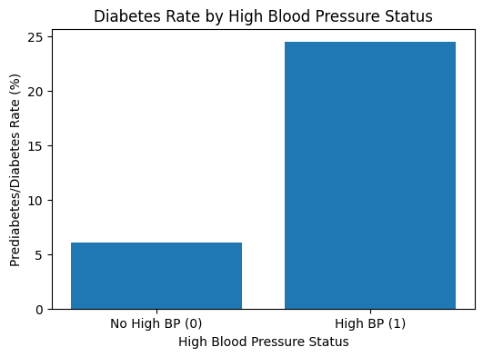
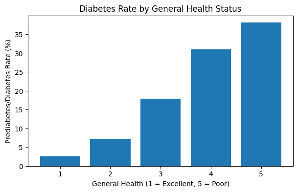
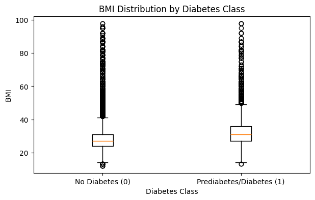
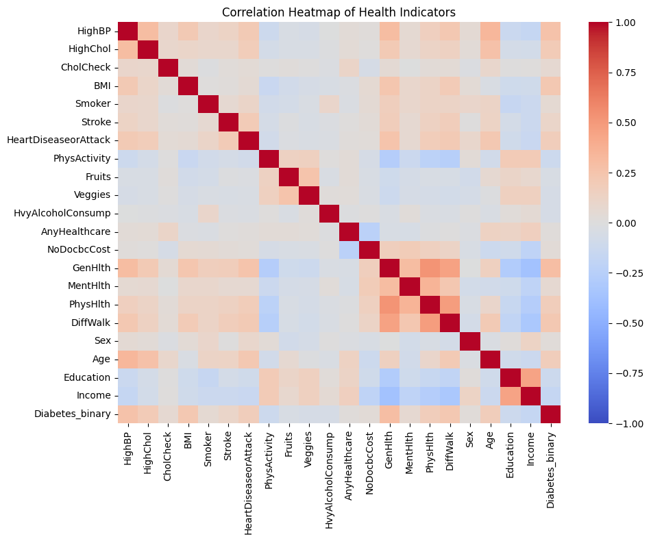

# Diabetes Risk Prediction Using Machine Learning

## Project Overview
This project explores how machine learning can predict diabetes risk using health-related indicators from the CDC Diabetes Health Indicators dataset.

The goal is to evaluate different classification algorithms and determine how effectively they can identify individuals who may be at risk for diabetes.

## Technologies Used
- Python
- Pandas
- Scikit-learn
- Google Colab
- Logistic Regression
- Decision Tree
- Random Forest
- Cross-Validation
- Hyperparameter Tuning

## Methodology
The project involved data preparation, model training, and evaluation. Logistic Regression and Decision Tree models were developed using health-related predictors.

Stratified cross-validation and hyperparameter tuning were used to evaluate and improve model performance.

## Key Results
- Logistic Regression ROC AUC: 0.8196
- Tuned Decision Tree ROC AUC: 0.8112
- Decision Tree cross-validation ROC AUC improved from 0.5870 to 0.8145 following hyperparameter tuning.

## My Contribution
This was a collaborative academic project for ISM 6405. My individual contributions focused on Logistic Regression, Decision Tree classification, cross-validation, and hyperparameter optimization.

## Conclusion
The results demonstrate how machine learning can identify patterns associated with diabetes risk. Logistic Regression provided strong overall performance, while Decision Tree tuning significantly improved the model's ability to distinguish between diabetes classifications.

These findings highlight the importance of evaluating multiple models and balancing different performance metrics.

## Exploratory Data Analysis

### Diabetes Rate by High Blood Pressure

Respondents with high blood pressure had a higher observed diabetes/prediabetes rate than those without high blood pressure.

### Diabetes Rate by General Health

The diabetes/prediabetes rate increased as self-reported general health declined.

### BMI Distribution by Diabetes Class

Respondents with diabetes/prediabetes generally had higher BMI values.

### Correlation Heatmap

This visualization shows the relationships among the health indicators.

### Class Distribution

The dataset contains considerably more respondents without diabetes than respondents with diabetes/prediabetes.

### BMI Distribution

